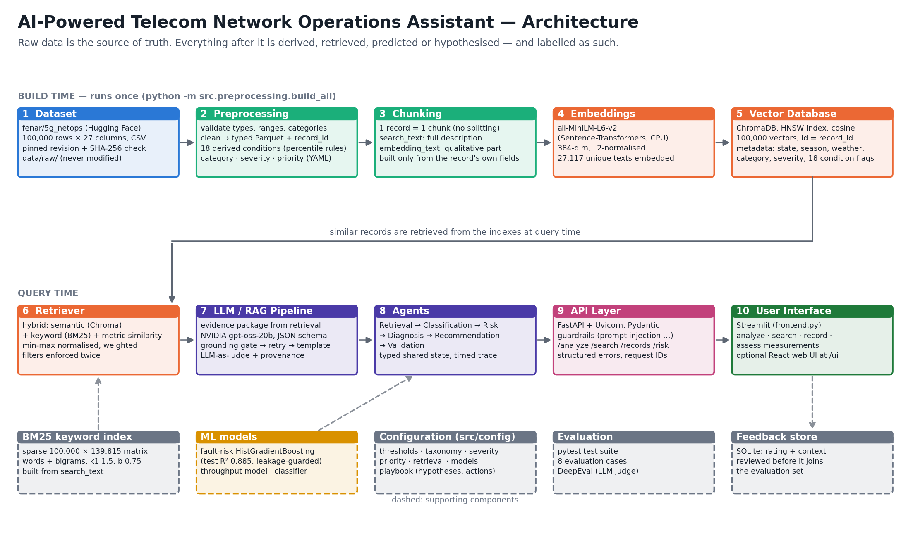

# Architecture



*(Regenerate with `python docs/make_architecture_diagram.py`.)*

## Layers

| Layer | Responsibility | Code |
|---|---|---|
| **Data** | Pinned download + checksum, inspection, validation, cleaning, record IDs | `src/preprocessing/download_dataset.py`, `inspect_dataset.py`, `loader.py`, `validator.py`, `cleaner.py`, `processor.py` |
| **Feature engineering** | Derived conditions, taxonomy, severity, priority, search texts | `src/preprocessing/conditions.py`, `taxonomy.py`, `severity.py`, `priority.py`, `documents.py`, `build_incidents.py` |
| **Retrieval** | Embeddings → ChromaDB, BM25, filters, query understanding, metric similarity, hybrid ranking | `src/rag/*`, `src/preprocessing/build_index.py` |
| **ML** | Fault-risk regression, throughput regression, category classifier, leakage guard | `src/services/models/*` |
| **LLM / agents** | Evidence, classification, risk, root cause, recommendations, grounded LLM narrative, LLM-as-judge, provenance, report; 6 agents + orchestrator | `src/services/*`, `src/rag/llm_provider.py`, `src/rag/pipeline.py`, `src/agents/*` |
| **API** | FastAPI, Pydantic schemas, structured errors, request IDs, feedback | `src/main.py`, `src/api/schemas.py`, `src/services/feedback.py` |
| **Frontend** | React web UI (main, served at `/ui`) and the Streamlit UI (Phase 28); both call the API only | `frontend/src/*`, `frontend.py` |
| Shared | Config loading, text normalisation, state names | `src/utils/*` |
| Config | Every threshold, weight and rule | `src/config/*.yaml` |

## Data flow

```
5G_netops_data_100K.csv.xz  (raw, 27 columns, source of truth)
  └─ processor  → records.parquet       (27 raw fields typed + record_id + 4 dq flags)
      └─ build_incidents → incidents.parquet  (+18 cond_* flags, category, severity, priority, texts)
          ├─ build_index → chroma/ (100k vectors) + bm25/ (sparse matrix)
          └─ train       → models/*.joblib + docs/models/*.json

query ─▶ guardrails ─▶ RetrievalAgent ─▶ ClassificationAgent ─▶ RiskAgent ─▶ DiagnosisAgent
      ─▶ RecommendationAgent (+ LLM narrative, grounding check) ─▶ ValidationAgent (+ LLM judge)
      ─▶ JSON + Phase 29 report ─▶ FastAPI ─▶ React web UI / Streamlit ─▶ feedback (SQLite → evaluation review)
```

## Folder structure (Phase 31)

```
capstone-agent/
├── app/                 main application: API, RAG pipeline, retrieval, analysis, models, LLM, UI, config
│   ├── analysis/        evidence, classification, risk, root cause, recommendations, narrative, grounding, judge, report
│   ├── config/          schema / thresholds / taxonomy / severity / priority / retrieval / models / playbook (.yaml)
│   ├── llm/             provider abstraction (Anthropic / offline)
│   ├── models/          fault-risk, throughput, classifier, training
│   ├── retrieval/       embeddings, ChromaDB store, BM25, filters, query parser, metric similarity, hybrid
│   ├── ui/              Streamlit app (Phase 28)
│   ├── main.py          FastAPI app
│   ├── pipeline.py      single-pipeline RAG (reference implementation)
│   ├── guardrails.py, schemas.py, feedback.py
├── src/agents/              6 agents, shared state, orchestrator
├── frontend/            React + TypeScript web UI (Vite); `npm run build` → dist/, served at /ui
├── data/                ingestion + processing scripts (raw/processed data are git-ignored)
├── docs/                documentation, diagram, generated reports (phase1/, models/, evaluation/)
├── tests/               pytest suites per phase + evaluation/ (cases, DeepEval runner)
├── src/utils/               config loading, text helpers, state names
├── requirements.txt
├── Dockerfile, docker-compose.yml, .env.example, pytest.ini
```

Two deviations from the literal specification, both forced by the spec's own Phase 31 layout:
- The Phase 2 modules live in `data/`, not `src/data/`.
- Configuration lives in `src/config/`, not a top-level `config/`.
